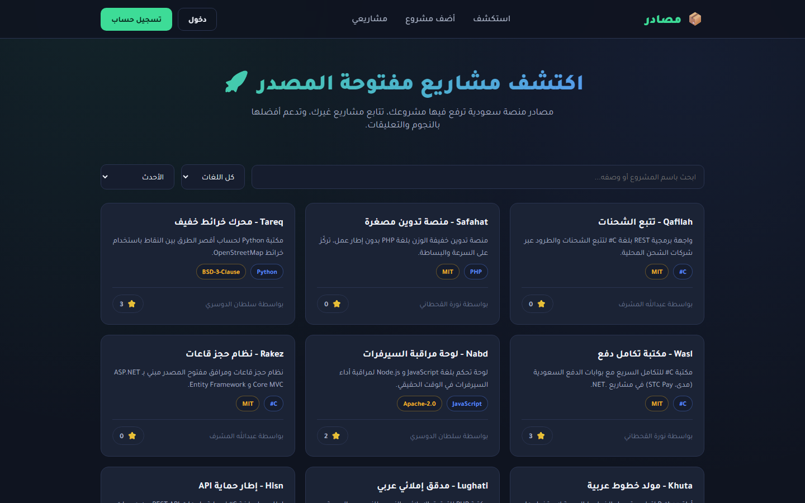
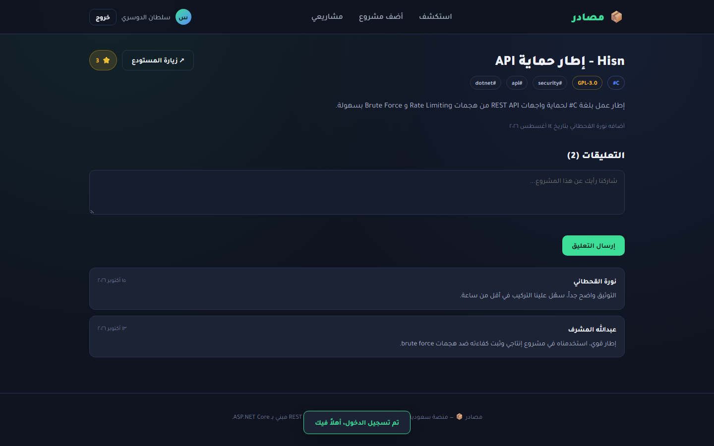
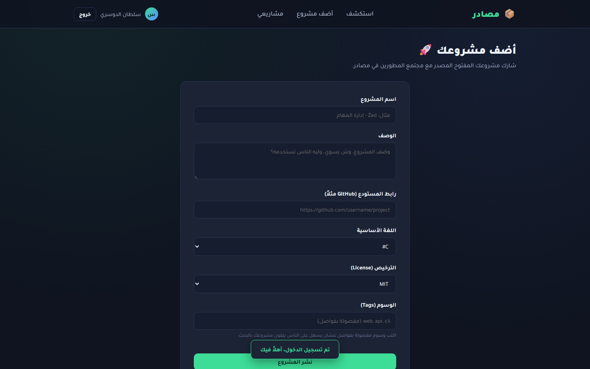
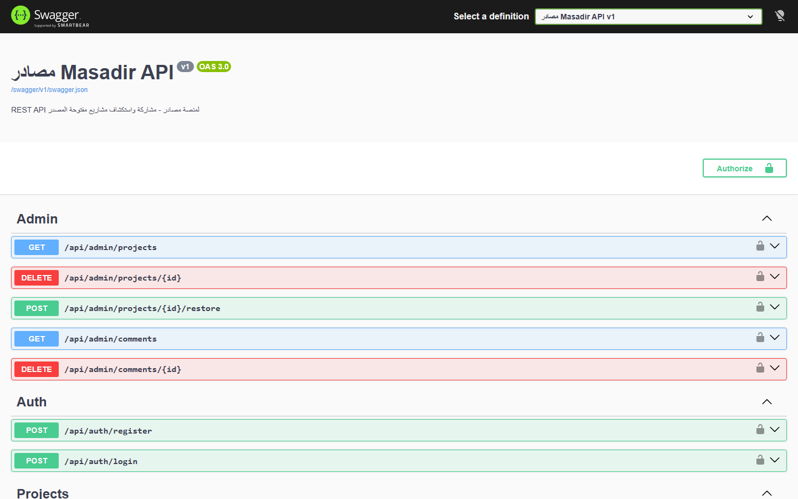

# مصادر 📦

منصة سعودية تخليك ترفع مشاريعك المفتوحة المصدر، تستكشف مشاريع غيرك، تدعم اللي يعجبك بنجمة ⭐، وتسولف عليها بالتعليقات. بنيتها كـ REST API كامل بـ ASP.NET Core + واجهة أمامية SPA مكتوبة بـ JavaScript خام بدون أي فريموورك، عشان أبرز مهاراتي في تصميم واجهات برمجية RESTful نظيفة.



## وش فيه

- تسجيل حساب ودخول عبر JWT، مع صلاحيتين: مطوّر (Contributor) ومشرف (Admin)
- إضافة، تعديل، وحذف المشاريع (عنوان، وصف، رابط المستودع، اللغة، الترخيص، الوسوم)
- بحث فوري + فلترة حسب اللغة + ترتيب حسب الأحدث أو الأكثر تميزاً + تصفح بصفحات (pagination)
- نظام نجوم (Star) تقدر تفعّله وتلغّيه على أي مشروع، ويتحدث العداد فوراً
- تعليقات حقيقية على كل مشروع، مع نموذج إضافة تعليق مباشر
- لوحة إدارة للمشرف، يقدر منها يشيل أي مشروع أو تعليق غير مناسب ويرجّعه لو احتاج
- صفحة "مشاريعي" تعرض كل اللي رفعته وعدد نجومها
- توثيق API كامل عبر Swagger على `/swagger`
- بيانات تجريبية جاهزة: 3 مستخدمين و 12 مشروع متنوع و تعليقات حقيقية

## صور


صفحة تفاصيل مشروع "Hisn" وعليها النجوم والتعليقات والوسوم.


نموذج نشر مشروع جديد بتصميم بسيط وواضح.


توثيق تفاعلي كامل لكل نقاط الـ API عبر Swagger UI.

## بيانات تجربة

| الدور | البريد | كلمة المرور |
|---|---|---|
| مشرف (Admin) | `admin@masadir.sa` | `Admin@12345` |
| مطوّر (Contributor) | `dev1@masadir.sa` | `Dev@12345` |
| مطوّر (Contributor) | `dev2@masadir.sa` | `Dev@12345` |

## التشغيل

```bash
# استنساخ المستودع
git clone https://github.com/Mazencoder1/masadir.git
cd masadir

# استرجاع الحزم
dotnet restore

# تشغيل المشروع (قاعدة البيانات تتبنى وتتعبى بالبيانات التجريبية تلقائياً أول تشغيل)
dotnet run --urls http://localhost:5103
```

بعدها افتح المتصفح على:

- الواجهة: `http://localhost:5103`
- توثيق الـ API (Swagger): `http://localhost:5103/swagger`

> ملاحظة: قاعدة البيانات (SQLite) تتولّد تلقائياً من خلال `DbContext.Database.EnsureCreated()` + Seeder يشتغل أول ما تشغّل المشروع، فما تحتاج تسوي أي خطوة يدوية إضافية.

## التقنيات

- ASP.NET Core 10 Web API
- Entity Framework Core + SQLite (قابلة للتبديل بسهولة لـ SQL Server، بس تغيّر الـ connection string والـ provider)
- JWT Authentication
- Vanilla JavaScript SPA (بدون React/Vue/Angular) مع Router بسيط يعتمد على الـ hash
- Swagger / OpenAPI
